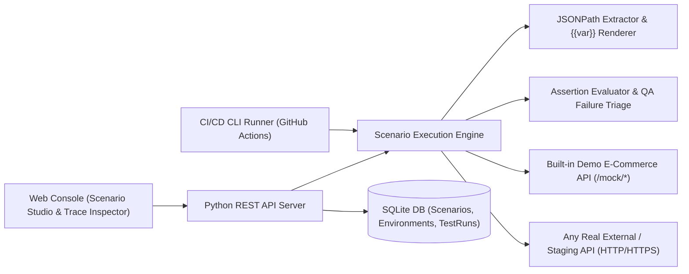

# ⚡ PulseAPI — Automated API Testing & Scenario Orchestration Platform

[](https://github.com/liu88219/api-test-platform/actions/workflows/ci.yml)
[](https://github.com/liu88219/api-test-platform/actions/workflows/deploy-pages.yml)

🌐 **線上互動展示平台 (Live Interactive Demo)：[https://liu88219.github.io/api-test-platform/](https://liu88219.github.io/api-test-platform/)**

> **QA / SDET Portfolio Flagship Project**  
> 一套基於 **Python (FastAPI 架構) + Web Console + SQLite** 打造的生產級 **API 自動化測試與多步驟場景編排平台**。支援跨步驟動態變數提取（JSONPath $\rightarrow$ `{{variable}}`）、多維度自動化斷言引擎、CI/CD 命令列品質守門員（Quality Gate），以及內建的**靶機故障模擬器（Chaos Bug Simulator）**與**自動化 QA 根因診斷（Failure Triage）**。

---

## ✨ 核心技術亮點 (Key Highlights)

1. **🔗 多步驟 API 鏈路編排與動態變數傳遞 (Multi-Step Variable Chaining)**
   * 支援從任意步驟的 HTTP Response 中透過 **JSONPath**（如 `$.data.token`、`$.data.products[0].id`）提取動態資料並寫入共享 Context Pool。
   * 後續步驟可在 URL Path、Request Headers、Request Body 中直接以 `{{auth_token}}`、`{{active_cart_id}}` 佔位符引用，自動保留原生資料型別（`int` / `float` / `str`）。
2. **✅ 多維度斷言驗證引擎 (Multi-Dimensional Assertion Engine)**
   * 支援驗證 **HTTP Status Code**、**JSONPath 欄位值**、**Response Header**、以及 **回應時間 SLA (`response_time_ms < 200ms`)**。
   * 支援運算子：`eq`、`neq`、`gt`、`gte`、`lt`、`lte`、`contains`、`not_empty`、`exists`。
3. **🤖 自動化 QA 失敗根因診斷 (Automated Failure Triage)**
   * 當測試步驟失敗時，自動分析 HTTP 狀態碼與斷言差異，區分 **「後端服務 5xx 崩潰」**、**「401/403 權限 Token 失效」**、**「商業邏輯金額/資料斷言不符」** 或 **「效能 SLA 超標」**。
4. **💥 內建電商微服務靶機與 Chaos Bug 注入開關 (Live Chaos Engineering Demo)**
   * 內建完整模擬電商 API（`/mock/auth/login`、`/mock/products`、`/mock/cart/items`、`/mock/orders/checkout`）。
   * 網頁頂部提供 **Chaos Bug 切換器**：可一鍵模擬「結帳金額多扣 500 元 Bug」或「金流服務 500 Crash」，即時展示平台如何攔截線上缺陷。
5. **🛡️ 真實外部 API 驗證 + CI/CD CLI Runner**
   * 可在「測試環境配置」中將 `Base URL` 改為任何真實服務（如 `http://localhost:3000` 或外部公開 API），發送真實 HTTP 請求進行自動化驗證。
   * 內建 `backend/cli_runner.py` 與 `.github/workflows/ci.yml`，支援在 GitHub Actions 中作為自動化 Quality Gate 執行。

---

## 🏗️ 系統架構圖 (System Architecture)



---

## 🚀 快速啟動指南 (Quick Start)

### 1. 啟動 Web 測試平台伺服器
專案採用零外部依賴相容設計，只要有 `Python 3.10+` 即可一行指令啟動（同時包含後端 API、內建電商靶機與前端控制台）：

```bash
python3 -m backend.app.server
```
啟動後打開瀏覽器訪問：**`http://localhost:8080`**

### 2. 在終端機 / CI/CD 執行自動化測試套件 (CLI Quality Gate)

```bash
# 執行全量 API 測試場景驗證
python3 backend/cli_runner.py

# 模擬後端「結帳金額計算錯誤 Bug」並驗證平台是否成功攔截 (預期 Exit Code = 1)
python3 backend/cli_runner.py --chaos pricing_bug
```

### 3. 執行平台核心引擎單元測試 (Unit Tests)

```bash
python3 -m unittest discover -s backend/tests -v
```

---

## 📂 專案目錄結構

```text
api-test-platform/
├── backend/
│   ├── app/
│   │   ├── engine/
│   │   │   ├── extractor.py     # JSONPath 解析器與 {{variable}} 模板渲染引擎
│   │   │   ├── asserter.py      # 多維度斷言驗證器與 QA 失敗根因診斷邏輯
│   │   │   └── runner.py        # 多步驟 HTTP 場景調度執行器
│   │   ├── database.py          # SQLite 資料持久化與預設測試場景 Seed
│   │   ├── mock_ecommerce.py    # 內建電商靶機 API 與 Chaos 故障注入器
│   │   ├── service.py           # 測試執行與批次調度服務層
│   │   ├── main.py              # FastAPI 應用程式入口
│   │   └── server.py            # 內建 HTTP 伺服器 (零依賴即可直接啟動)
│   ├── tests/
│   │   └── test_engine.py       # 測試引擎自身的單元與整合測試
│   ├── cli_runner.py            # CI/CD 命令列測試執行器
│   └── requirements.txt
├── frontend/
│   └── dist/                    # Web 控制台前端介面 (Scenario Studio / Trace Inspector)
├── docs/
│   └── TEST_STRATEGY.md         # 測試策略、等價劃分與邊界值設計矩陣文件
├── .github/workflows/ci.yml     # GitHub Actions 自動化 CI 流水線
└── docker-compose.yml           # Docker 一鍵啟動配置
```
